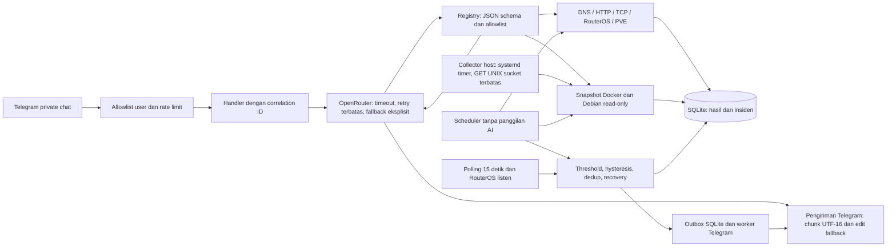

# AI NMS Homelab

Asisten NOC berbahasa Indonesia untuk Telegram. Bot memilih tool monitoring dari registry terbatas, mengambil bukti aktual, lalu menjelaskan fakta, dugaan, dan keterbatasan. Tidak tersedia shell AI, perubahan RouterOS, administrasi Proxmox, atau Docker socket di container bot.

## Advanced NMS — 27 Oktober 2026

Inventaris kini dapat didaftarkan ke collector bersama; topologi dapat merujuk perangkat persisten dan menyimpan informasi port/VLAN. API manajemen menggunakan role granular, preview, konfirmasi sekali pakai, audit dan verifikasi; tidak ada shell bebas. MikroTik memakai adapter baca dengan opt-in akun elevated, sementara write memerlukan API-SSL terverifikasi. Proxmox tetap monitoring. [Kontrak, hasil verifikasi dan batas implementasi](docs/ADVANCED-PLATFORM-2026-10-27.md).

## Arsitektur



`bot.py` tetap menjadi entry point kompatibel. Modul berada di `app/ai`, `app/telegram`, `app/monitoring`, `app/alerts`, `app/storage`, dan `app/services`. Host collector berdiri sendiri, tidak menerima input model dan tidak membuka listener jaringan.

## Fitur dan batas pemeriksaan

| Komponen | Bukti yang diperiksa | Batas |
|---|---|---|
| Telegram | API, allowlist user, private chat, pengiriman/edit | Uji API bukan bukti input manusia telah diterima |
| OpenRouter | Respons nonkosong, tool calls, HTTP/error classification | Ketersediaan dan kuota model gratis dapat berubah |
| Technitium | Query A UDP dengan fallback TCP melalui dnspython | Bukan pemeriksaan seluruh konfigurasi DNS |
| HTTP/HTTPS | GET streaming, status HTTP, validasi sertifikat | Redirect tidak diikuti; bukan transaksi aplikasi end-to-end |
| Debian | CPU delta `/proc/stat`, memory available, uptime, filesystem | Sampel CPU pertama UNKNOWN/null |
| Docker | State, health, image, restart, CPU/RAM, limit, ports, jumlah marker error log | Tidak membaca env, mount, label, atau mengekspor raw log |
| MikroTik | Identity/resource/clock, interface counters; detail jaringan opsional | Wajib `read,api`; `test` dan login Winbox read-only yang sudah ada diterima; hak perubahan/sensitif tetap ditolak |
| Proxmox | Node, versi, VM/LXC, resource/storage dan task ringkas | Membutuhkan token PVEAuditor dan CA TLS |

Status `UP`, `DEGRADED`, `DOWN`, `UNKNOWN` selalu disertai metode dan timestamp. `DOWN` pada TCP hanya berarti koneksi endpoint gagal. Sertifikat TLS tidak valid menghasilkan `UNKNOWN`, bukan bypass verifikasi. Interface running tidak membuktikan VLAN atau routing berfungsi. MAC/DHCP/network details hanya dapat dibaca melalui tool bagian terkait yang diaktifkan admin; tidak ada config export menyeluruh.

## Instalasi dan update

Persyaratan host: Docker Compose, Python 3 untuk host collector, dan systemd. Salin `.env.example` ke `.env`, isi rahasia di server, lalu `chmod 600 .env`. Jangan commit atau menyalin `.env` ke build context. Akun container adalah UID/GID 10001, root filesystem read-only, kapabilitas dihapus, memory 256 MiB dan CPU 0.75.

```sh
cd /mnt/data/www/nms-bot
sudo install -d -m 700 -o 10001 -g 10001 data
sudo install -d -m 755 /var/lib/nms-collector /usr/local/lib/nms-collector
sudo install -m 644 deploy/host_collector.py /usr/local/lib/nms-collector/host_collector.py
sudo install -m 644 deploy/nms-collector.service deploy/nms-collector.timer /etc/systemd/system/
sudo systemctl daemon-reload
sudo systemctl enable --now nms-collector.timer
sudo systemctl start nms-collector.service
sudo docker build --target test -t nms-bot:test .
sudo docker run --rm --network none nms-bot:test
sudo docker compose config --quiet
sudo docker compose build nms-bot
sudo docker compose up -d --no-deps nms-bot
sudo docker compose ps
sudo docker logs --tail 50 nms-bot
```

Sebelum update, backup kode, `.env`, database dan Compose ke direktori root-only di luar build context. Tag image aktif sebagai image rollback. Buat backup SQLite online menggunakan API `sqlite3.Connection.backup()` atau hentikan hanya service NMS sebelum menyalin DB/WAL. Jangan menyalin DB aktif tanpa WAL. Ulangi tes dan review Compose sebelum recreate. Jangan menjalankan `compose down`, menghapus volume, atau mem-prune image/volume.

## Konfigurasi

| Variabel | Penggunaan/default |
|---|---|
| `TELEGRAM_BOT_TOKEN` | Rahasia bot; wajib |
| `ALLOWED_TELEGRAM_ID` / `ALLOWED_TELEGRAM_IDS` | User ID positif, bentuk jamak dipisah koma |
| `OPENROUTER_API_KEY` | Rahasia provider; opsional untuk monitoring/alert tanpa AI |
| `OPENROUTER_MODEL` | Model utama, default `openrouter/free` |
| `OPENROUTER_FALLBACK_MODELS` | Model tambahan eksplisit dipisah koma; maksimal tiga model total |
| `OPENROUTER_BASE_URL` | HTTPS, default `https://openrouter.ai/api/v1` |
| `LOG_LEVEL` | Default INFO; log JSON dengan redaksi rahasia dan correlation ID |
| `DATA_DIR`, `SNAPSHOT_DIR` | `/data`, `/collector` di container |
| `DOCKER_IGNORED_CONTAINERS` | Daftar nama persis container maintenance yang memang boleh berhenti; tetap tampil di dashboard, tanpa alert |
| `TARGETS_FILE` | File JSON allowlist admin; default target dalam `app/config.py` |
| `MONITOR_INTERVAL` | Default 180 detik, minimum 30; deployment ini 60 |
| `RETENTION_DAYS` | Hasil/insiden, default 30 hari |
| `ALERTS_ENABLED` | Aktifkan notifikasi; default false pada instalasi baru |
| `ALERT_CHAT_ID` | Wajib termasuk allowlist; default user ID terkecil |
| `ALERT_COOLDOWN` | 600 detik per kondisi; trafik mempertahankan timer setelah recovery. Link fisik, eskalasi dan perangkat lain tetap segera |
| `DAILY_SUMMARY_ENABLED` | Ringkasan sekali per hari Asia/Jakarta, default false |
| `CPU_THRESHOLD`, `MEMORY_THRESHOLD`, `STORAGE_THRESHOLD` | Default 90 persen; hysteresis 5 poin |
| `MIKROTIK_HOST`, `MIKROTIK_PORT` | Host internal tetap; utamakan 8729/API-SSL |
| `MIKROTIK_USER`, `MIKROTIK_PASSWORD` | Akun monitoring khusus |
| `MIKROTIK_SSL_VERIFY` | Wajib true pada API-SSL |
| `MIKROTIK_CA_FILE` | Path PEM CA internal yang dimount read-only; kosong = CA sistem |
| `MIKROTIK_READONLY_CONFIRMED` | Default false; aktifkan setelah akun minimal disiapkan; diverifikasi ulang saat runtime |
| `MIKROTIK_ALLOW_PLAINTEXT` | Default false; pengecualian eksplisit untuk API 8728 internal tepercaya |
| `MIKROTIK_NETWORK_DETAILS_ENABLED` | Default false, izin baca DHCP/IP/route/VLAN |
| `MIKROTIK_INTERFACES` | Nama persis dipisah koma; pada continuous kosong = semua etherN fisik, dengan baseline awal diam |
| `PROXMOX_URL` | HTTPS host/port API, default endpoint homelab |
| `PROXMOX_HOST`, `PROXMOX_PORT` | Kompatibilitas konfigurasi host/port bila URL belum diisi |
| `PROXMOX_SSL_VERIFY` | Wajib true; gunakan CA internal, bukan bypass sertifikat |
| `PROXMOX_TOKEN_ID`, `PROXMOX_TOKEN_SECRET` | Token khusus read-only; jangan gunakan root password |
| `PROXMOX_CA_FILE` | Path PEM CA yang dimount read-only jika CA internal |
| `PROXMOX_EXPECTED_GUESTS` | VMID yang diharapkan running, dipisah koma |
| `DASHBOARD_ENABLED`, `DASHBOARD_PASSWORD` | Dashboard privat, password minimal 24 karakter; username `nms` |
| `CONTINUOUS_ENABLED`, `NETWORK_CONFIG_FILE` | Aktifkan polling jaringan dan inventaris private IPv4 pada `/app/network.json` |
| `NETWORK_INTERVAL`, `MIKROTIK_INTERFACE_EVENTS` | 15 detik; subscription RouterOS listen aktif dengan polling cadangan |
| `TRAFFIC_ZERO_SECONDS`, `TRAFFIC_RESUME_SECONDS` | RX dan TX sama-sama nol selama 300 detik; pemulihan setelah salah satu arah kembali positif selama 60 detik |
| `TRAFFIC_BASELINE_ALERTS_ENABLED` | Default false: fluktuasi relatif baseline tidak menghasilkan notifikasi |
| `TRAFFIC_WARMUP_SAMPLES`, `TRAFFIC_MIN_BASELINE_BPS` | Aturan baseline opsional: 5 sampel, minimum 100.000 bit/detik |
| `TRAFFIC_MIN_SPIKE_BPS`, `TRAFFIC_SPIKE_FACTOR`, `TRAFFIC_SPIKE_SECONDS` | Aturan baseline opsional: >1 Mbit/detik dan >2× baseline selama 60 detik |
| `TRAFFIC_DROP_PERCENT` | Aturan baseline opsional: <=10% baseline; dinonaktifkan pada deployment ini |
| `BANDWIDTH_WARNING_PERCENT`, `BANDWIDTH_CRITICAL_PERCENT` | Lebih dari 85% WARNING / 95% CRITICAL pada kapasitas Ethernet yang benar-benar dibaca |
| `BANDWIDTH_SUSTAIN_SECONDS`, `BANDWIDTH_HYSTERESIS_PERCENT` | 30 detik bertahan, hysteresis 5 poin; timer terputus saat sampel gagal |
| `WIREGUARD_STALE_SECONDS` | 180 detik usia handshake; hanya peer aktif dengan keepalive yang diharapkan selalu tersambung |

File allowlist admin berbentuk objek ID → konfigurasi. Model hanya menerima ID, bukan IP/URL bebas. Perubahan file ini membutuhkan build/mount eksplisit admin; model tidak dapat mengubahnya. Contoh:

```json
{"cloud_storage":{"name":"Cloud storage","kind":"web","url":"https://cloud.internal.example/"}}
```

Endpoint portfolio/cloud memakai domain HTTPS yang ditemukan di konfigurasi Nginx Proxy Manager dan diverifikasi langsung dari container. Port aplikasi 18080/18081 tetap bind loopback host; binding layanan lain tidak diubah. Redirect 302 cloud ke login menunjukkan endpoint HTTP merespons, belum membuktikan login/upload/database end-to-end.

Setiap perangkat ICMP dalam `network.json` mempunyai boolean `alert_on_unreachable`. Default false untuk perangkat baru: tetap diperiksa dan ditampilkan, tanpa notifikasi UP/DOWN. Aktifkan hanya untuk perangkat yang memang diharapkan selalu online. Gateway, server, DNS, Proxmox host dan TLWR820N menggunakan true; iPhone, ajilll dan laptop THEAZ menggunakan false. Tidak membalas ping hanya membuktikan tidak ada balasan pada pemeriksaan tersebut. IP DHCP dapat berubah; bot tidak menyimpulkan pemilik alamat masih sama.

## MikroTik: persiapan akun oleh administrator router

Tersedia 28 bagian data yang bisa diminta melalui bahasa biasa atau command `/mikrotik`. Panduan langkah Winbox, tabel bagian/filter, contoh, dan status verifikasi ada di [panduan MikroTik](docs/MIKROTIK.md); hasil pengujian/deployment tercatat di [laporan perluasan MikroTik](docs/MIKROTIK-2026-10-19.md). Fitur/paket yang tidak terpasang menghasilkan UNKNOWN dengan penjelasan. Dukungan kode tidak berarti koneksi live sudah berhasil: akun dan transport harus lolos pemeriksaan lebih dahulu.

Bot tidak membuat user atau mengubah permission router. Administrator disarankan menyiapkan grup khusus `read,api` saja, lalu user khusus dengan pembatasan alamat sumber server NMS. Akun yang sudah memakai `read,winbox,api` tetap read-only bila tidak memiliki hak perubahan; collector menerima login Winbox tersebut tanpa menambah hak akun. `test` tetap opsional. Hak write, policy, reboot, password, sensitive, sniff, FTP, SSH, rest-api dan hak lain ditolak. Hindari grup bawaan `read`, yang dapat mencakup reboot/password/sensitive. `winbox` mengizinkan akses/login (juga autentikasi bandwidth test), sedangkan `write` mengizinkan perubahan konfigurasi; keduanya tidak disamakan. Rujukan: [policy RouterOS](https://help.mikrotik.com/docs/spaces/ROS/pages/8978504/User).

Login API diberi maksimum 10 detik, sedangkan setiap pembacaan maksimum 5 detik dan selalu dibatasi sisa deadline collector 15 detik. Waktu antre ikut dihitung dalam anggaran request 19 detik, sehingga pembacaan interface tidak langsung gagal ketika pemeriksaan sistem masih login. Tidak ada retry login otomatis tanpa batas. Error koneksi/log membedakan fase transport, login, pembacaan akun/grup, dan data; durasi login dicatat tanpa password atau argumen login.

Pada ringkasan `/status` dan scheduler, system lalu interface MikroTik dijalankan bergiliran agar masing-masing mendapat jendela timeout sendiri. Collector layanan lain tetap berjalan paralel dengan batas concurrency aplikasi. Hasil terbaru, bukti koneksi live, dan batas provider AI tercatat dalam [laporan perbaikan koneksi](docs/MIKROTIK-KONEKSI-2026-10-19.md).

Timeout login boleh dicoba ulang satu kali setelah 0,2 detik, sebelum query akun/data apa pun. Koneksi sebelumnya ditutup dan percobaan kedua hanya memakai sisa deadline 15 detik yang sama. Autentikasi ditolak, izin berlebih, dan kegagalan query data tidak diulang otomatis.

Utamakan API-SSL dengan sertifikat yang dipercaya dan hostname/IP SAN cocok. Tambahkan CA internal ke image/trust store bila diperlukan. API 8728 tanpa TLS membawa kredensial plaintext; hanya boleh digunakan melalui pengecualian eksplisit pada jaringan internal tepercaya dengan firewall sumber yang ketat. Aplikasi tidak mengubah konfigurasi firewall/API/router untuk menyiapkannya.

## Proxmox: persiapan token

Di Datacenter → Permissions, administrator membuat user khusus tanpa hak admin, kemudian API token dengan privilege separation. Beri role `PVEAuditor` pada path `/` dengan propagate kepada user DAN token sesuai model permission Proxmox; effective token permissions merupakan irisan hak user dan token. Jangan memakai `root@pam` atau role Administrator. Bila ruang lingkup lebih kecil diperlukan, batasi path node/pool/VM dan sesuaikan hasil parsial yang diharapkan.

Isi `PROXMOX_TOKEN_ID=user@realm!token-name` dan `PROXMOX_TOKEN_SECRET` langsung di `.env` permission 600. Pasang CA cluster yang telah diverifikasi melalui akses tepercaya sebagai file read-only di container, isi `PROXMOX_CA_FILE`. Jangan menonaktifkan validasi TLS. Tanpa token atau CA valid, collector melaporkan UNKNOWN. Dokumentasi rujukan: [Proxmox API dan token](https://pve.proxmox.com/pve-docs/pve-admin-guide.html#pveum_tokens), [OpenRouter tool calling](https://openrouter.ai/docs/guides/features/tool-calling).

## Alert dan riwayat

Satu proses memegang lock pada volume data, dengan task scheduler, heartbeat, notifier, dan pemantauan jaringan yang terpisah. Tidak ada job database yang diduplikasi setelah restart. Seluruh task monitoring/notifikasi tidak memanggil AI. Cache layanan 60 detik dan polling interface 15 detik membatasi beban perangkat. Kegagalan layanan dan recovery membutuhkan dua sampel berturut-turut; link DOWN yang sudah dikonfirmasi tidak ditunda. Kegagalan collector teknis membutuhkan tiga; kredensial belum tersedia tidak dianggap outage layanan. Resource memakai hysteresis 5 poin. Pending alert dan state bertahan setelah restart, tanpa spam setiap polling. Recovery tidak disimpulkan dari UNKNOWN.

Restart container dideteksi dari kenaikan counter minimal tiga dalam jendela 15 menit, bukan counter seumur hidup. Container maintenance lama yang memang exited bisa dikecualikan secara eksplisit; jangan memakai wildcard yang menyembunyikan kegagalan baru. VM stopped hanya menjadi alert bila ID-nya masuk `PROXMOX_EXPECTED_GUESTS`. Interface penting harus masuk `MIKROTIK_INTERFACES`. Tidak ada auto-remediation.

SQLite menyimpan hasil monitoring, state alert, event/recovery dan metadata operasional. Retensi default 30 hari dibersihkan setiap hari. Pesan percakapan, prompt pengguna, token, header autentikasi, env container dan raw log tidak disimpan. Volume dan backup harus dilindungi karena data topologi masih bersifat internal.

## Dashboard privat

Dashboard memakai data SQLite yang sama, refresh tampilan 30 detik, tanpa memicu pemeriksaan atau completion baru. Tersedia status collector, resource Debian, container/VM, DNS, counter interface, alert aktif, event dan grafik maksimal 120 sampel. Klik Detail untuk metode dan bukti tiap target. Angka yang belum tersedia tidak digantikan data dummy.

Port `8765` hanya dipublish ke `127.0.0.1` host. Gunakan SSH tunnel dari komputer pribadi:

```sh
ssh -N -L 8765:127.0.0.1:8765 azril@192.168.20.195
```

Buka `http://127.0.0.1:8765`, username `nms`. Password baru dashboard dibuat di server dan disimpan hanya dalam `.env` mode 600; ambil sendiri lewat sesi SSH tepercaya dengan `sudo sed -n 's/^DASHBOARD_PASSWORD=//p' /mnt/data/www/nms-bot/.env`. Jangan menyalin nilainya ke chat/log/repository.

HTTP Basic berjalan di dalam SSH tunnel terenkripsi, dengan perbandingan password constant-time, pembatasan autentikasi gagal, Host/Origin check, tanpa CORS, no-store, CSP, proteksi frame dan endpoint GET read-only. Tidak ada cookie atau session token persisten aplikasi. Tutup tunnel dan jendela browser privat setelah digunakan karena browser dapat menyimpan autentikasi Basic. Akses publik/reverse proxy belum diaktifkan. Jika kelak diperlukan akses multiuser, tambahkan autentikasi sesi/SSO dan HTTPS sebelum memperluas binding.

## Format pesan Telegram

Pertanyaan lanjutan memakai rujukan tool sementara per user privat, maksimal empat perangkat/bagian/filter selama 10 menit dan maksimal 64 user. Tidak ada teks percakapan, jawaban AI atau angka monitoring yang disimpan sebagai memori percakapan. Rujukan ini hanya memilih tool; pertanyaan kondisi tetap mengambil hasil tool saat itu. Pertanyaan metrik singkat seperti `RAMnya berapa?` langsung membaca komponen sebelumnya dan hanya menampilkan field metrik relevan, sehingga model tidak dapat memindahkannya dari Docker ke Debian. Jika rujukan berisi lebih dari satu komponen, bot meminta nama perangkat. Pertanyaan dengan target baru atau analisis sebab tetap mengikuti jalur agent. Gunakan `/reset` untuk menghapus rujukan. Restart juga menghapusnya. Pertanyaan umum tanpa tool tidak menghapus topik monitoring sebelumnya. Analisis bersamaan dari user yang sama ditolak dengan pesan tunggu agar rujukan tidak saling menimpa; `/reset` saat analisis berjalan tetap berlaku.

Permintaan `semua`, `daftar`, `lengkap`, `rinci` atau `detail` menambahkan daftar fakta dari collector setelah pengantar AI. Seluruh baris yang berhasil diambil ditampilkan, termasuk daftar container dan field bertingkat dalam bentuk poin, bukan dict mentah. Untuk MikroTik, aplikasi mengambil maksimal lima halaman tambahan per pertanyaan dengan section/filter sama; pengambilan otomatis juga dibatasi ukuran data. Jumlah sebenarnya bisa lebih sedikit. Sisa data selalu mempunyai penanda dan `next_offset`; tulis `lanjutkan` untuk mengambil satu halaman berikutnya tanpa completion AI baru. Batas 500 baris per snapshot dan 160 karakter per field dari collector tetap berlaku. Daftar ini tidak dinyatakan sebagai salinan seluruh konfigurasi router.

Hasil gagal/UNKNOWN dan menu parsial ditambahkan oleh aplikasi sehingga tidak hilang dari ringkasan AI. Proxmox VM/LXC tanpa token dibedakan sebagai **Belum disiapkan**, termasuk bila endpoint HTTP PVE merespons. Klaim umum semua layanan sehat ditahan ketika ada data belum tersedia. Pengaman ini melengkapi prompt dan tool validation; analisis bahasa model tetap perlu dinilai bersama fakta/metode/cakupan yang ditampilkan.

Model yang mengabaikan `tool_choice=required` ditolak sebagai protocol error dan dialihkan hanya ke fallback yang sudah dikonfigurasi. Bila tool sudah menghasilkan data tetapi completion berikutnya gagal atau batas 150 detik tercapai, hasil tool tetap dikirim dengan keterangan bahwa ringkasan AI belum selesai. Kegagalan sebelum ada bukti tetap dijelaskan sebagai kegagalan, tanpa membuat data pengganti.

Hasil pengujian dan deployment fitur ini dicatat di [laporan AI sesuai konteks](docs/AI-KONTEKS-2026-10-19.md).

Jawaban AI ditampilkan dengan judul tebal, paragraf pendek dan poin yang nyaman dibaca di ponsel. Prompt melarang tabel dan heading Markdown `###`. Bila model tetap mengirim tabel, renderer Mistune mengubahnya menjadi daftar vertikal per target. Tanda `**` dan backtick diterjemahkan menjadi format Telegram HTML yang sesuai; output HTML mentah dari model/perangkat selalu di-escape.

Pesan panjang dipisahkan pada batas paragraf, baris atau kata dengan batas 3500 unit UTF-16. Setiap bagian mempunyai tag yang lengkap; entity dan emoji tidak dipotong di tengah surrogate pair. Jika Telegram menolak entity, bot mencoba satu kali dengan teks bersih tanpa markup. Timeout pengiriman tidak diulang otomatis. Preview tautan dimatikan agar tidak memenuhi chat. Command diagnostik/history tetap mempertahankan isi JSON literal.

Formatter yang sama dipakai jawaban AI, `/status`, alert dan ringkasan harian. Alert menampilkan bukti sebagai poin berlabel, bukan Python dictionary mentah. Pemformatan mengikuti [HTML Telegram Bot API](https://core.telegram.org/bots/api#html-style); tidak memakai HTML bebas dari provider.

## Command dan contoh respons

- `/start`, `/help`: panduan.
- `/status`: pemeriksaan layanan dan collector tanpa AI.
- `/ask pertanyaan` atau pesan biasa: natural-language agent.
- `/diagnostics`: versi dependency, status collector, completion terakhir, GET `/key` yang di-cache 10 menit. Tidak menjalankan completion berulang.
- `/history debian`: maksimal dua sampel terakhir.
- `/history` atau `/events`: kejadian dan recovery terakhir.
- `/alerts`: kondisi aktif dan status antrean Telegram.
- `/devices`: perangkat inventaris serta cakupan collector yang sudah/belum tersedia.
- `/mikrotik`: daftar bagian dan bantuan pembacaan langsung tanpa AI.
- `/mikrotik system`: identity, CPU, RAM, storage, versi, uptime dan waktu.
- `/mikrotik interfaces name=ether1`: counter dan detail interface tertentu.
- `/mikrotik traffic name=ether1`: RX/TX bit/detik dari dua pembacaan counter.
- `/mikrotik dhcp_leases 10`: halaman berikutnya, mulai baris ke-11.
- `/reset`: hapus rujukan topik/perangkat/halaman sementara untuk user ini.

Contoh format (bukan data aktual): `[UNKNOWN] proxmox_resources — PVE API missing_readonly_token`. Bot menjelaskan bahwa status VM belum diketahui, bukan bahwa Proxmox mati. Untuk pertanyaan “Apa itu DNS?”, AI boleh langsung menjelaskan tanpa tool. Untuk “Kenapa DNS saya tidak bisa diakses?”, AI wajib mengambil data aktual dan membedakan fakta dari kemungkinan penyebab.

## Pengujian dan troubleshooting

Unit test berjalan tanpa jaringan/rahasia, termasuk mock RouterOS, PVE, Docker snapshot, DNS, HTTP dan Telegram. Test AI mencakup jawaban umum, tool result ID, error tool, respons kosong/terpotong, JSON invalid, unknown tool, loop limit, fallback/rate limit/auth/network/timeout. Tes alert mencakup dedup, restart, hysteresis dan recovery. Tes keamanan memeriksa allowlist, private chat, redaksi dan penolakan parameter tambahan.

Untuk sintaks tanpa membuat pyc di filesystem read-only:

```sh
sudo docker run --rm --network none --entrypoint python nms-bot:local -c 'from pathlib import Path; [compile(p.read_text(),str(p),"exec") for p in Path("app").rglob("*.py")]'
sudo systemctl status nms-collector.timer nms-collector.service
sudo journalctl -u nms-collector.service -n 30 --no-pager
sudo docker inspect nms-bot --format '{{json .State.Health}}'
```

Lapisan diagnosis: (1) `/start` dan allowlist/private chat; (2) Telegram API getMe/getWebhookInfo tanpa mencetak token; (3) `/diagnostics` untuk koneksi/key provider; (4) satu pertanyaan umum; (5) satu pertanyaan monitoring dengan tool; (6) pengiriman/edit Telegram. HTTP sukses saja tidak dianggap jawaban AI berhasil. Log memisahkan `ai_failed`, `tool_failed`, `telegram_edit_failed`, dan `telegram_delivery_failed`.

401/403 → autentikasi; 402 → kredit/kuota; 429 → rate limit; 408/timeout → timeout; 5xx → server; 400/404 → model/tool. Retry hanya satu untuk network/server/timeout per model. Auth/quota tidak dialihkan ke model lain. Maksimal tiga putaran eksekusi tool dan satu jawaban akhir; seluruh analisis dibatasi 150 detik. Pesan Telegram dipecah berdasarkan unit UTF-16 dan tidak dipotong diam-diam. Timeout edit boleh beralih ke send; timeout send tidak diulang membabi buta karena pesan mungkin sudah terkirim.

Health check menilai heartbeat scheduler dan keterbaruan siklus; ini bukan jaminan seluruh collector UP. Bot tetap sehat ketika endpoint/credential tertentu UNKNOWN. Docker snapshot lebih tua dari 180 detik dianggap UNKNOWN. Container unhealthy tidak otomatis di-restart oleh healthcheck; periksa log dan penyebab sebelum tindakan admin.

Uji integrasi live harus dilaporkan terpisah dari unit test. Jangan menyatakan input Telegram manusia telah teruji jika hanya send/edit API atau update sintetis yang diuji.

## Rollback

Backup awal dan image rollback disimpan di `/mnt/data/backups/nms-bot` dan tag `nms-bot-rollback:<timestamp>`. Untuk rollback, hentikan hanya `nms-bot`, pulihkan file yang berubah dari backup ke direktori proyek, kemudian jalankan Compose lama dengan image rollback melalui override NMS. Jangan membangun image dari source baru saat rollback.

```yaml
# /tmp/nms-rollback.yaml; gunakan timestamp aktual hasil checkpoint
services:
  nms-bot:
    image: nms-bot-rollback:TIMESTAMP
```

```sh
sudo docker compose stop nms-bot
# Pulihkan bot.py, Dockerfile, requirements.txt, compose.yaml dan .env dari checkpoint root-only.
sudo docker compose -f compose.yaml -f /tmp/nms-rollback.yaml up -d --no-deps --no-build nms-bot
```

Untuk kembali ke versi tanpa host collector, disable hanya `nms-collector.timer`; jangan mengubah Docker daemon atau service aplikasi lain. Simpan data SQLite untuk investigasi, jangan hapus volume.

## Menambahkan collector

Tambahkan modul yang mengembalikan `target`, `method`, `status`, `timestamp`, dan data terpilih. Tetapkan timeout, ukuran output dan cache; jangan menerima URL/shell bebas. Daftarkan tool secara eksplisit dengan JSON schema `additionalProperties:false`. Tambahkan mock sukses/gagal/timeout dan tes allowlist. Untuk metrik baru tambahkan rule alert dengan hysteresis, simpan data minimal, lalu uji image sebelum deploy. Device comment/log merupakan data tidak tepercaya, bukan instruksi model.

## Temuan audit awal

Pada 19 Oktober 2026, OpenRouter key valid, model `openrouter/free` berhasil menjawab dan mengeluarkan tool call. Error yang tertangkap sebagai “Permintaan AI gagal” berasal dari `telegram.error.TimedOut` di `edit_text`, setelah `run_ai` selesai. Timeout default library adalah 5 detik untuk request biasa. Perbaikan memisahkan error transport Telegram dan AI, menaikkan timeout terukur, serta menyediakan jalur fallback pengiriman.

Hook startup juga memverifikasi ulang identitas bot sebelum membuat task: PTB 22.5 dapat mempertahankan flag initialized setelah `getMe` timeout, sehingga bootstrap retry melewatkan pemuatan identitas. Health check kini memeriksa poller/updater sudah berjalan. Model fallback deployment telah diuji secara langsung; bukan sekadar dipilih dari katalog.

Proyek awal belum berupa Git repository dan hanya punya dua tool TCP. Backup file penting dan tag image telah dibuat sebelum perubahan. Akun RouterOS yang ditemukan memakai grup bawaan `read` dengan hak tambahan; aplikasi menolak akun tersebut untuk monitoring API sampai akun minimal disediakan. Token PVE belum tersedia. Temuan CPU router 100% adalah satu sampel audit, bukan rata-rata atau diagnosis akar gangguan jaringan.

## Monitoring perubahan otomatis — 20 Oktober 2026

Fitur baru memakai proyek dan scheduler yang sama. Aktifkan CONTINUOUS_ENABLED=true, NETWORK_INTERVAL=15, MONITOR_INTERVAL=60, dan ALERTS_ENABLED=true. Inventaris alamat hasil audit serta uplink Cisco berada di network.json; tidak ada pemindaian subnet. Kredensial tetap pada .env mode 600 dan tidak dimasukkan ke network.json.

- Ethernet ether1–ether4 dipantau otomatis; MIKROTIK_INTERFACES dapat membatasi nama interface. Baseline awal diam sehingga port kosong tidak langsung dianggap insiden. Perubahan berikutnya mengirim DOWN/UP dan recovery.
- RouterOS /interface/listen memakai koneksi baca dengan verifikasi policy. Polling 15 detik tetap berjalan; counter link-downs membantu menemukan gangguan singkat di antara polling. Tidak ada penerima trap publik atau perubahan konfigurasi router.
- RX/TX dihitung dari delta byte dan selang aktual. Sampel pertama, gap panjang, kegagalan collector dan counter reset bernilai belum diketahui. Aturan aktif memerlukan RX dan TX sama-sama nol selama 5 menit dengan link running; satu notifikasi dikirim. Pemulihan memerlukan trafik positif pada salah satu arah selama 1 menit berturut-turut. Sampel gagal memutus timer, tanpa menganggap data sebagai nol atau pulih. Trafik nol diberi label tidak ada trafik teramati, bukan perangkat/internet putus. Notifikasi spike/drop relatif baseline lama dinonaktifkan.
- Persentase memakai rate hasil `/interface ethernet monitor ... once`, bukan advertised speed. Pada full duplex dipakai maksimum RX/TX; half duplex memakai jumlahnya. WARNING >85% / CRITICAL >95% selama 30 detik, termasuk konfirmasi eskalasi. Pemulihan harus bertahan 30 detik di bawah ambang hysteresis. Kapasitas virtual/WireGuard, link down dan kapasitas yang belum terbaca tidak diberi persentase palsu. Kapasitas Ethernet bukan kapasitas paket ISP.
- WireGuard membaca usia handshake, byte RX/TX dan endpoint tanpa private/preshared/public key. Handshake yang melewati 180 detik pada peer dengan keepalive memicu perubahan setelah konfirmasi; interface running saja bukan bukti tunnel sehat.
- Route aktif/non-disabled dibandingkan dari snapshot lengkap; kejadian menyimpan perubahan, tanpa mengeksekusi rekomendasi.
- Sembilan alamat inventaris hasil audit diperiksa melalui ICMP datagram tanpa NET_RAW. Enam perangkat infrastruktur mengirim alert; tiga klien pribadi hanya observasi. Tidak merespons ICMP belum membuktikan host mati. Nama klien berasal dari DHCP saat audit; perubahan alamat DHCP membutuhkan pembaruan inventaris.
- Cisco teridentifikasi melalui dua link LACP ether3/ether4. Perubahan uplink dipantau dari sisi MikroTik. IP manajemen, kredensial dan SNMP/traps Cisco belum tersedia; 24 port internal dan resource switch belum dapat dipastikan.
- Debian, Docker, DNS dan HTTP tetap dipantau. VM/LXC Proxmox masih membutuhkan token PVEAuditor dan CA TLS yang tepercaya.

Notifikasi selalu memuat perangkat, kejadian, keparahan, waktu WIB dan status pemulihan. Antrean SQLite mempertahankan ALERT dan RECOVERY sebagai kejadian terpisah, termasuk setelah restart. Untuk trafik, cooldown 600 detik dihitung dari ALERT sebelumnya dan tetap berlaku setelah recovery; recovery dari siklus yang alert-nya ditahan juga tidak dikirim. Recovery menunggu alert terkait yang masih retry. Gangguan perangkat lain, perubahan route berbeda, eskalasi bandwidth dan perubahan link fisik tetap diproses tanpa tertahan cooldown trafik. Status suppressed berarti notifikasi ditahan oleh kebijakan, bukan kegagalan monitoring. Retry transport memakai backoff 5–300 detik dan maksimal lima percobaan. RetryAfter Telegram dihormati. Timeout pengiriman ditandai uncertain dan tidak dikirim ulang otomatis karena pesan mungkin sudah sampai.

Saat kebijakan diperbarui, incident baseline/iPhone lama dinonaktifkan dengan event RETIRED, bukan RECOVERY. Pending notification dari aturan yang dinonaktifkan dibatalkan; riwayat lama tetap tersedia. Detail alasan dan hasil uji kebijakan versi 1.1.1 ada di [laporan perbaikan spam](docs/ALERT-TRAFIK-NOL-2026-10-20.md).

Notifikasi tidak memanggil AI. API key AI boleh kosong; monitoring, /status, /alerts, /devices, /history, /events dan /mikrotik tetap berfungsi. Jika batas harian model gratis OpenRouter tercapai, bot menjelaskannya tanpa mencoba model gratis lain dari akun yang sama berulang kali. AI dapat memakai get_incidents untuk menjelaskan riwayat nyata; /events menampilkan catatan langsung tanpa AI.

Router `openrouter/free` dapat memilih model berbeda pada setiap permintaan. Respons dari model khusus klasifikasi moderasi yang teridentifikasi (`content-safety`/`llama-guard`) ditolak sebagai jawaban asisten, lalu memakai fallback eksplisit yang sudah dikonfigurasi. Label safe/unsafe dan HTTP 200 tidak dianggap jawaban NOC. Ketersediaan/kuota fallback tetap diperiksa pada setiap request; tidak ada fallback gratis yang dijamin selalu tersedia.

Riwayat metrik jaringan disimpan sekitar satu menit sekali dan saat validitas berubah; kejadian disimpan segera. Retensi mengikuti RETENTION_DAYS. Antrean sent/failed/uncertain ikut dibersihkan setelah retensi, sedangkan pending dipertahankan hingga terkirim atau melewati batas percobaan. ID kejadian tetap meningkat setelah pembersihan agar cursor notifikasi tidak kehilangan kejadian baru.

Uji kabel fisik tidak dilakukan karena pengguna belum memiliki port cadangan aman. Pengujian DOWN/UP menggunakan simulasi berlabel dalam database sementara dan pengiriman Telegram nyata; data monitoring produksi tidak dipalsukan. Lihat laporan deployment di docs/MONITORING-OTOMATIS-2026-10-20.md untuk hasil aktual dan keterbatasan.


## Integrasi Dashboard React — Phase 3

Frontend Windows kini membaca cache SQLite yang sama dengan bot melalui HTTP API privat dan sesi server. Endpoint read-only, autentikasi, tunnel SSH, deployment serta rollback didokumentasikan di [DASHBOARD-API-PHASE3.md](docs/DASHBOARD-API-PHASE3.md). Uji final 23 Oktober 2026: 204 tes backend lulus; service NMS healthy, getMe Telegram berhasil dan poller_ready=true. Proxmox resources masih tertahan validasi TLS, Cisco SNMP belum dikonfigurasi. Tidak ada endpoint perubahan konfigurasi perangkat yang diaktifkan.


## Dashboard Phase 4 — Logs dan Insiden

API read-only log monitoring dan insiden tersedia pada /api/logs, /api/incidents dan /api/incidents/{id}. Riwayat memakai proyeksi transaksional SQLite dari event engine yang sama dengan Telegram. ACK/resolusi manual, log aplikasi mentah, audit administratif dan syslog belum diaktifkan. Kontrak, pengujian, batas data, status pengiriman dan rollback tersedia di [DASHBOARD-PHASE4.md](docs/DASHBOARD-PHASE4.md). Hasil final: 214 tes backend dan 56 tes frontend lulus; hanya service NMS yang direcreate.
