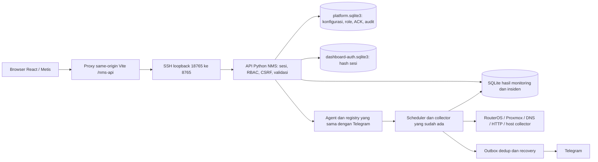

# Unified NMS — implementasi dan verifikasi 24 Oktober 2026

Frontend React 0.5.0 berada di Windows `C:/Users/Hype G12/Downloads/nms-dashboard`. Backend Python 1.2.0 tetap di Debian `192.168.20.195:/mnt/data/www/nms-bot`. Template Metis Bootstrap Admin 3.6.0 dan dependensi proyek dipertahankan. Ini implementasi bertahap platform NMS, bukan klaim semua fitur roadmap sudah tersedia.

## Hasil audit dan perbaikan

- Proxmox semula ditolak oleh gate TLS karena verifikasi dimatikan dan CA belum terpasang. CA publik yang dikirim administrator kini dipasang di `data/certs/pve-root-ca.pem`; verifikasi sertifikat tetap aktif. Token yang sudah ada berhasil dipakai. Hak API diperiksa lagi pada setiap pengambilan data; hak non-Audit ditolak.
- Endpoint web Proxmox sebelumnya menguji API anonim yang membutuhkan autentikasi. Probe web kini memakai root UI, sedangkan resource memakai API bertoken. HTTP 401 bukan bukti node mati.
- Phase 4 hanya memiliki jurnal monitoring. Sekarang tersedia sumber log aplikasi NMS yang disanitasi, audit administratif, dan ACK insiden yang terpisah dari resolusi.
- Halaman konfigurasi/layanan/topologi sebelumnya belum memiliki penyimpanan backend. Kini konfigurasi NMS disimpan di SQLite dengan revisi dan deteksi konflik 409.
- Status stale diperiksa berdasarkan interval collector, termasuk layanan HTTP dinamis. URL berubah membatalkan kecocokan hasil lama; layanan yang dihapus tidak meninggalkan collector aktif palsu.
- Counter disk QEMU tidak dianggap sebagai penggunaan filesystem VM. Nilai tersebut tetap tidak tersedia sampai metode pengumpulan yang sesuai ditambahkan.
- Drag node sempat mengganggu klik ganda karena pointer capture berada pada SVG induk. Capture kini berada pada node; klik ganda, drag, dan penyimpanan posisi diuji melalui browser.
- Saat verifikasi akhir, akun MikroTik memiliki policy administratif. Collector menolak pembacaan lanjutan dengan `excessive_or_unverified_permissions`. Koneksi login berhasil; penghalang saat ini adalah hak akses. Tidak ada gate keamanan yang dilonggarkan atau konfigurasi router diubah otomatis.

## Arsitektur



Refresh browser membaca cache/SQLite. Layanan HTTP yang diaktifkan lewat katalog masuk ke scheduler yang sama. Browser tidak melakukan polling langsung ke perangkat. Tool AI hanya read-only. AI gagal tidak menghentikan scheduler, penyimpanan, atau pengiriman alert.

## Kemampuan dan status nyata

| Modul | Hasil | Batas |
| --- | --- | --- |
| Proxmox | PASS: TLS dan token API, PVE 9.2.2, node pve, VM 100 DNS-Technitium dan VM 101 Web-Server running, tiga storage | Tidak ada LXC pada hasil aktual; filesystem QEMU tidak dikumpulkan; tidak ada start/stop/exec |
| Debian & Docker | PASS: snapshot resource host dan container dari collector terbatas yang sudah ada | Tidak ada socket Docker administratif di bot; tidak mengekspor raw log container |
| DNS | PASS: query DNS Technitium aktual dan health HTTP console | Statistik/konfigurasi API Technitium menunggu token khusus |
| NPM & phpMyAdmin | PASS: HTTP 200 dan observasi terjadwal dari engine bersama | Bukan bukti transaksi database/auth aplikasi berhasil |
| Portainer launcher | PASS: URL konfigurasi dan detail collector Docker | Status Docker bukan verifikasi login/TLS Portainer |
| MikroTik / routing / WireGuard / RX-TX | BLOCKED: akun saat ini berpolicy berlebihan; status UNKNOWN dengan diagnostik | Administrator harus memakai grup hanya read dan api; lalu ulangi verifikasi data nyata |
| Cisco SF200-24 | BLOCKED: alamat manajemen dan akses SNMP belum diketahui | Observasi neighbor bukan bukti seluruh 24 port terpantau |
| Topology | PASS: banyak topologi, CRUD node/relasi, grup, drag, pan/zoom, pencarian, simpan/muat ulang, status collector | Garis manual tidak membuktikan kesehatan koneksi fisik; overlay tidak menimpa posisi |
| Integrations & Launcher | PASS: CRUD, enable/disable, grup/pencarian, tes HTTP atau pembacaan cache, sidebar dinamis, monitoring HTTP opsional | URL host allowlist; credential perangkat tetap di server; autentikasi aplikasi asal tetap terpisah |
| Inventaris | PASS: metadata CRUD/import/export, daftar observasi pasif, persetujuan konfigurasi | Memilih API/SNMP pada form tidak memasang collector/kredensial baru; tidak ada scanning jaringan aktif |
| System Settings | PASS: identitas, timezone/format, interval, threshold, cooldown, retensi, notifikasi, allowlist host, maintenance dan backup/restore konfigurasi | Pengaturan diterapkan pada siklus berikutnya; tidak mencakup credential/akun/history dalam ekspor |
| Alert & Incident | PASS: satu engine, status persisten, ACK terpisah, maintenance mute, recovery, histori dan pengiriman | Tidak ada resolusi manual yang mengarang pemulihan atau auto-remediation; korelasi lintas perangkat lanjutan belum tersedia |
| Logs | PASS: jurnal hasil/event, log aplikasi NMS dan audit nyata, filter dan pagination | Remote syslog dan raw log aplikasi lain belum dikumpulkan |
| AI Assistant | PASS: job API dan agent OpenRouter aktual, jawaban menyebut kedua VM nyata, format teks/tabel aman | Model gratis/kuota dapat berubah; tidak ada percakapan persisten atau shell bebas |
| Reports | PASS: agregasi data nyata, coverage, tren resource, CSV dan print/save PDF browser | Availability adalah proporsi sampel collector UP dari sampel known, bukan SLA end-to-end; gap tidak diasumsikan sehat |
| Auth & roles | PASS: admin, Operator, Read-only operator, server RBAC, sesi/logout/revocation, audit | SSO/MFA, vault, pengaturan kebijakan sesi lewat UI belum tersedia |

## Endpoint dan kontrak

Prefix browser `/nms-api`; semua route backend memerlukan sesi valid. GET tidak melakukan perubahan perangkat. POST hanya mengubah konfigurasi NMS, anotasi, akun NMS, atau meminta pemeriksaan/analisis terbatas. Basic auth legacy tidak memberi hak administratif platform.

| Metode dan route | Akses / parameter | Respons |
| --- | --- | --- |
| POST `/api/auth/login` | `{username,password,remember?}` | User, expiry, cookie HttpOnly |
| GET `/api/auth/session`; POST `/api/auth/logout` | Sesi; logout `{}` | Identitas / pencabutan sesi |
| GET `/api/status`, `/api/devices`, `/api/devices/{id}`, `/api/services`, `/api/health` | Semua role; route monitoring lama dipertahankan | Snapshot terproyeksi, status, timestamp, stale dan error |
| GET `/api/logs`, `/api/incidents` | page/page_size/q/severity/device/from/to; logs:category/source; incidents:status | items, total, paging dan jendela waktu |
| GET `/api/incidents/{id}` | ID allowlist | Insiden, bukti, timeline, acknowledgment |
| GET `/api/platform` | Semua role | capabilities, settings, integrations, inventory, maintenance, topologies |
| GET `/api/platform/{collection}` dan `/{id}` | integrations/topologies/inventory/maintenance | `{items:[...]}` atau `{item:...}` |
| POST `/api/platform/{collection}` | Administrator; `{value:{...}}` | Record tersimpan dengan id/revision |
| POST `/api/platform/{collection}/{id}` | Administrator; `{revision,value:{...}}` | Revisi baru; 409 untuk revisi lama |
| POST `/api/platform/{collection}/{id}/delete` | Administrator; `{revision}` | `{ok:true}`; perangkat/layanan asal tidak dihapus |
| POST `/api/platform/integrations/{id}/test` | Administrator; `{}`; rate terbatas | Cache collector terkait atau HTTP status/error terkontrol |
| POST `/api/platform/inventory/import` | Administrator; `{devices:[...]}`; validasi atomik | Jumlah metadata tersimpan |
| GET/POST `/api/platform/settings` | Baca semua; tulis Administrator `{revision,value}` | Revisi, konfigurasi, applied_at |
| GET `/api/platform/export`; POST `/api/platform/restore` | Administrator; schema_version 1 | Backup/restore konfigurasi NMS atomik; tidak berisi secret |
| GET/POST `/api/platform/users` | Administrator; username/name/role/enabled/password?/revision? | Daftar aman / hasil perubahan; hash tidak diekspor |
| GET `/api/platform/audit` | Administrator; page/q | Aktivitas administratif, total dan paging |
| POST `/api/platform/acknowledge/{incident_id}` | Administrator/Operator; `{note}` maks300 | Anotasi persisten, tanpa resolusi atau notifikasi baru |
| GET `/api/platform/application-logs` | Administrator/Operator; page/q/level/from/to | Log NMS disanitasi, 25 per halaman; max31 hari |
| GET `/api/platform/report` | Semua role; target/from/to/resource? | Counts, availability sampel, coverage, points max241 |
| POST `/api/platform/ask`; GET `/api/platform/jobs/{id}` | Semua role; `{question}` maks2000; job hanya pemilik | Job running/complete/failed dan jawaban terbatas |

Payload contoh topologi:

```json
{"value":{"name":"Topologi saya","nodes":[{"id":"pve","name":"pve","kind":"proxmox","x":400,"y":100,"collector":"proxmox_resources","resource_id":"node/pve"}],"links":[]}}
```

Payload contoh integrasi, tanpa secret:

```json
{"value":{"name":"Technitium Console","url":"http://192.168.20.199:5380/","kind":"dns","group":"Homelab","enabled":true,"monitor_enabled":true,"poll_interval":60,"collector":"","authentication":"external"}}
```

`collector` yang diisi mengacu pada collector bersama dan menonaktifkan probe HTTP duplikat pada record itu. `authentication` mendokumentasikan cara login; bukan form penampung token. Target baru tetap harus disetujui dalam allowlist host server.

Semua object menolak field tidak dikenal, tipe/interval di luar batas dan URL dengan credential/query/fragment. Limit: 20 topologi; 100 node/200 relasi per topologi; 100 integrasi/40 HTTP monitor aktif; 200 inventaris; 100 maintenance window (maks7 hari); 50 akun. Restore maks2 MiB; konfigurasi biasa256 KiB; autentikasi4 KiB. API client timeout8 detik, responsmaks2 MiB; probe7 detik, header16 KiB, tidak mengikuti redirect, IP hasil DNS dipin dan alamat berbahaya ditolak. AI maks1 job web berjalan,3 permintaan/menit, jobTTL10 menit. Limit global120 req/menit/alamat, login10 kegagalan/menit. Error:400 validasi,401 sesi tidak valid,403 role/Origin,404 tak ditemukan,409 konflik,429 rate limit,503 ketidaktersediaan.

## Keamanan, alert dan penyimpanan

- Cookie HttpOnly/SameSite Strict; expiry normal8 jam/idle30 menit, remember7 hari/idle1 hari. Token sesi di-hash di server. Perubahan role/password/status mencabut sesi lama. Password user baru minimum16; bootstrap admin minimum24 karakter. PBKDF2-SHA256600000 iterasi/salt acak. Akun nms tetap read-only.
- API saat ini loopback lewat SSH, bukan hosting publik. Cookie Secure wajib saat gateway HTTPS produksi dipasang; jangan mengekspos HTTP loopback ini ke internet.
- Secret hanya `.env` server permission600 dan file credential privat. Tidak ada secret di VITE_*, localStorage, bundle atau backup konfigurasi. CA publik bukan private key.
- `platform.sqlite3` menyimpan konfigurasi/revisi/ACK/audit; `dashboard-auth.sqlite3` sesi; `nms.sqlite3` hasil monitoring, insiden, outbox dan log aplikasi. File600. Retensi hasil/log mengikuti setting (saat ini30 hari), audit365 hari. Backup menggunakan API SQLite online.
- Engine alert lama tetap tunggal: interface DOWN terkonfirmasi, hysteresis/cooldown perkey, trafik nol300 detik dan recovery60 detik. Baseline spike/drop lama tetap nonaktif sesuai pilihan pengguna. Cooldown600 detik tidak menahan gangguan perangkat lain. Maintenance hanya menahan notifikasi, bukan koleksi/histori; masalah yang masih aktif setelah window berakhir diberitahukan sekali. Tidak ada uji cabut kabel produksi.
- Embedding hanya ditawarkan dari probe HTTP terbaru yang tidak melarang frame. CSP/X-Frame-Options tidak diubah. Technitium/phpMyAdmin melarang frame sehingga memakai launcher. Frame NPM dapat dimuat sebagai dokumen, tetapi aplikasi di dalamnya tampak kosong pada browser uji; fungsi login/dashboard embedded **belum terverifikasi**. Gunakan tombol dashboard asli. Tidak ada proxy terbuka atau penerusan credential.

## Pengujian dan deployment

| Pemeriksaan | Hasil |
| --- | --- |
| Backend compileall dan container test terisolasi `--network none --read-only` | PASS:244 tes |
| Frontend ESLint, node test, Vite production build | PASS:66 tes, lint bersih, build berhasil; warning chunk ApexCharts besar masih ada |
| Uji API live sebelumnya | PASS:21 skenario CRUD, izin, konflik, SSRF, histori, export, AI/status nyata; detail `unified-live-api-checks.json` |
| Verifikasi API setelah final deployment | PASS:12 pemeriksaan; MikroTik BLOCKED; detail `unified-final-api-checks.json` |
| AI aktual | PASS:jawaban dari agent nyata berisi kedua nama VM; `unified-ai-check.json` |
| Browser | Login admin, halaman resource Proxmox/VM, CRUD topologi/drag/save/reload/delete, katalog CRUD/disable/validasi URL, log/filter, setting konfirmasi, audit dan sesi; hasil tambahan dicatat di `unified-browser-checks.json` |
| Container NMS | PASS: image `nms-bot:unified-final-20261024`, healthy, restart0 pada pemeriksaan |
| Container lain | PASS: ID container sebelum/sesudah identik; tidak ada compose down, restart host/PVE atau perubahan router |

Frontend dijalankan lokal melalui `powershell -NoProfile -File scripts/start-local.ps1`; buka `http://127.0.0.1:5173/`. Build tersedia di dist tetapi belum dihosting publik. API prefix dan tunnel mengikuti `API-INTEGRATION.md`; kontrak baru di dokumen ini menggantikan keterbatasan Phase3/4 yang sudah diselesaikan.

Akun `admin` tersimpan di file privat `%USERPROFILE%/.ssh/nms-dashboard-admin-login.json` dan server `/home/azril/.config/nms/dashboard-admin-login.json`. Akun `nms` tetap memakai file privat lama. Jangan menyalin nilainya ke chat, source atau log.

Backup deployment terakhir: `/mnt/data/www/nms-bot/backups/unified-final-20261024` berisi source, imageID, env, daftar container dan snapshot SQLite online sebelum patch. Image rollback `nms-bot:unified-final-rollback-20261024`. Rollback kode: pulihkan source dari checkpoint, tag image rollback menjadi `nms-bot:local`, validasi Compose lalu `docker compose up -d --no-deps --no-build nms-bot`. Pertahankan DB terbaru; restore DB hanya bila dibutuhkan dan setelah backup kondisi terkini. Jangan menimpa data baru dengan salinan lama secara otomatis.

## Pekerjaan administrator / roadmap berikutnya

1. MikroTik: Winbox → System → Users → Groups, grup `nms-monitor` hanya `read,api`; Users → pindahkan `NMS-HomeServer` ke grup itu. Tidak perlu memberikan write/policy/sensitive/reboot. Setelah perubahan, uji lagi interface/traffic/routing/WireGuard. Utamakan API-SSL terverifikasi; pengecualian plaintext lama tidak diperluas.
2. Cisco: temukan IP manajemen dari dokumentasi/ARP/neighbor yang diizinkan dan siapkan SNMP read-only (utamakan v3). Belum dilakukan pemindaian luas atau perubahan switch.
3. Technitium: token khusus API statistik bila statistik diperlukan. Credential cukup disimpan di backend melalui prosedur administrator.
4. Tahap berikutnya: onboarding collector dinamis non-HTTP dengan secret store, korelasi insiden lintas perangkat, syslog opt-in, histori trafik lebih kaya, widget per-user, report PDF server, SSO/MFA dan hosting HTTPS produksi. Fitur tersebut belum dinyatakan selesai.

Referensi resmi Proxmox: [permission dan token](https://github.com/proxmox/pve-docs/blob/master/pveum.adoc), [sertifikat](https://github.com/proxmox/pve-docs/blob/master/certificate-management.adoc).
